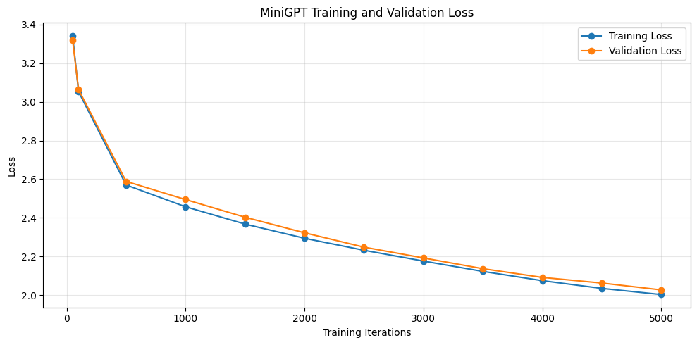

# MiniGPT — GPT Language Model from Scratch

A decoder-only Transformer language model built using PyTorch. MiniGPT implements the core components of GPT architecture and generates Shakespeare-style text using the Tiny Shakespeare dataset.

## Architecture

```text
Input Text
    |
    v
Character Tokenizer
    |
    v
Token IDs
    |
    v
Token Embeddings
    +
Positional Embeddings
    |
    v
Transformer Blocks
    |
    +-----------------------------+
    | Layer Normalization         |
    | Causal Self-Attention       |
    | Residual Connection         |
    | Layer Normalization         |
    | Feed-Forward Network        |
    | Residual Connection         |
    +-----------------------------+
    |
    v
Final Layer Norm
    |
    v
Linear Head
    |
    v
Next-Character Logits
    |
    v
Probability Sampling
    |
    v
Generated Text
```

## Tech Stack

- Python
- PyTorch
- NumPy
- Matplotlib
- Pytest
- Google Colab

## Model Configuration

| Parameter | Value |
|---|---:|
| Dataset | Tiny Shakespeare |
| Vocabulary size | 65 |
| Embedding dimension | 64 |
| Attention heads | 4 |
| Transformer layers | 4 |
| Context length | 128 |
| Dropout | 0.1 |
| Optimizer | AdamW |
| Learning rate | 0.0003 |

## Training Results

| Metric | Result |
|---|---:|
| Training iterations | 5,000 |
| Final training loss | 2.0037 |
| Final validation loss | 2.0276 |
| Automated tests | 82 passed |

### Training and Validation Loss

The graph illustrates the model's learning progress during the initial 10,000-iteration experiment.



## Text Generation

Supports autoregressive text generation using:

- Temperature sampling
- Top-K sampling

| Configuration | Temperature | Top-K |
|---|---:|---:|
| Balanced | 0.8 | 10 |
| Predictable | 0.6 | 5 |
| Diverse | 1.0 | 20 |

## Project Structure

```text
MiniGPT/
├── data/
├── tokenizer/
├── models/
├── training/
├── tests/
├── checkpoints/
├── generate_text.py
├── requirements.txt
└── README.md
```

## Run the Project

Clone the repository and install dependencies:

```bash
git clone https://github.com/likithha500/MiniGPT.git
cd MiniGPT
pip install -r requirements.txt
```

Download Tiny Shakespeare into `data/raw/tinyshakespeare.txt`.

Train the model:

```bash
python -m training.run_training
```

Generate text:

```bash
python generate_text.py
```

Run tests:

```bash
python -m pytest -v
```

## Objective

MiniGPT is an educational implementation focused on understanding GPT-style language models, covering tokenization, embeddings, attention, Transformer architecture, training, evaluation and autoregressive text generation.

**Built with PyTorch for educational purposes.**

[GitHub Repository](https://github.com/likithha500/MiniGPT)
